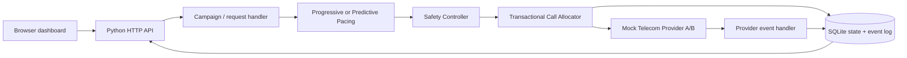
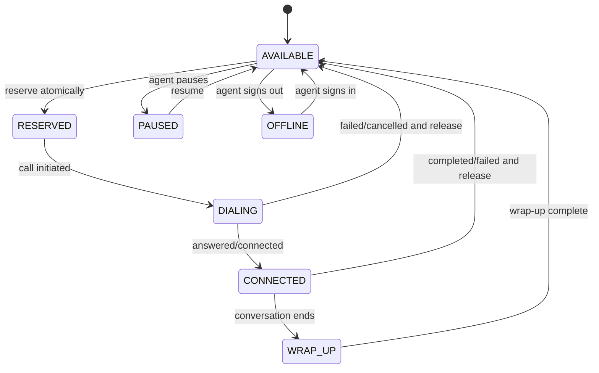
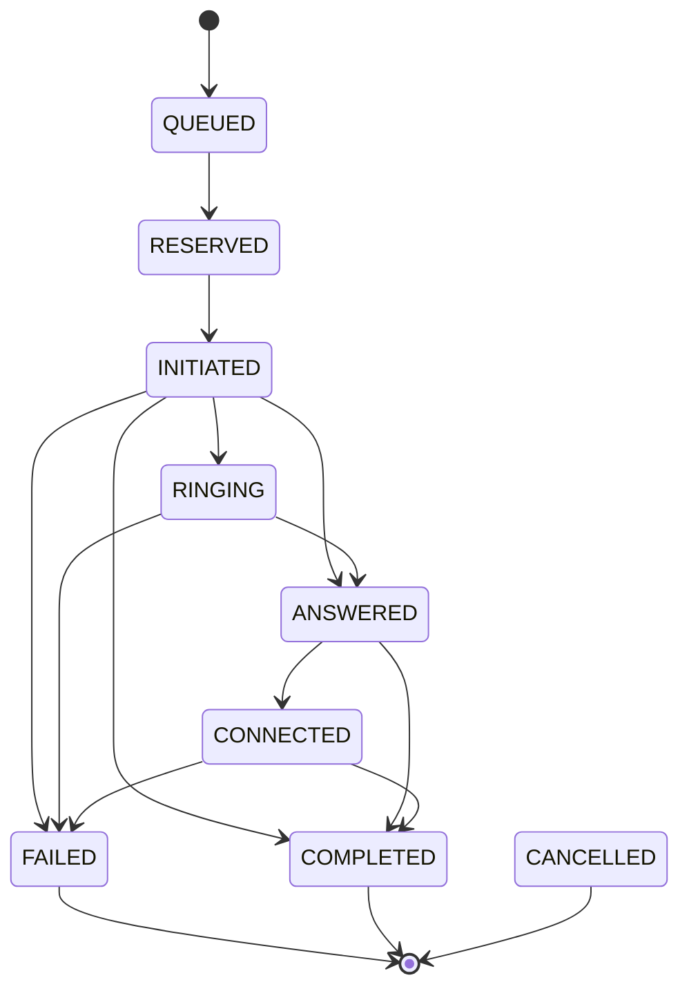

# Architecture

The pacing engine proposes a requested count. It does not have provider access. The Safety Controller reads current agent/borrower/call state and limits the approved count. The allocator then conditionally reserves agents and borrowers inside a database transaction. Provider callbacks are applied through a separate event handler.

## Agent state machine

The prototype implements the core states needed for allocation and cleanup. `PAUSED`, `OFFLINE`, and `WRAP_UP` are documented lifecycle states but are not yet exposed as UI actions.

## Call state machine

The implementation keeps an explicit transition allow-list. Duplicate event IDs are ignored, and a terminal state cannot be reopened.
