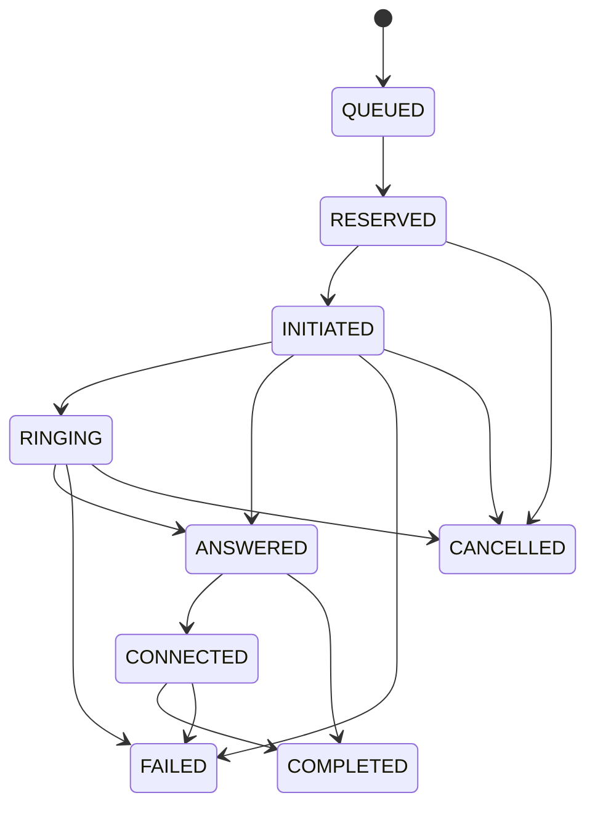

# State machines

## Agent lifecycle

```mermaid
stateDiagram-v2
  [*] --> OFFLINE
  OFFLINE --> AVAILABLE: login/heartbeat
  AVAILABLE --> RESERVED: atomic reservation
  RESERVED --> DIALING: provider request accepted
  DIALING --> CONNECTED: answer/connection event
  CONNECTED --> WRAP_UP: conversation ends
  WRAP_UP --> AVAILABLE: wrap-up complete
  AVAILABLE --> PAUSED: agent pauses
  PAUSED --> AVAILABLE: resume
  AVAILABLE --> OFFLINE: logout/heartbeat timeout
  RESERVED --> OFFLINE: agent disappears; call failed/reconciled
  DIALING --> OFFLINE: agent disappears; call failed/reconciled
```

Prototype note: the local implementation uses `AVAILABLE`, `RESERVED`, `DIALING`, `CONNECTED`, `OFFLINE`, and `PAUSED` where relevant. `WRAP_UP` is part of the documented target lifecycle but is not yet driven by a full agent-workflow UI.

## Call lifecycle

`COMPLETED`, `FAILED`, and `CANCELLED` are terminal. Provider event IDs are unique, and invalid/out-of-order transitions are audited and ignored. A `COMPLETED` event received from a setup state is accepted as a terminal event to tolerate missing intermediate provider callbacks.
